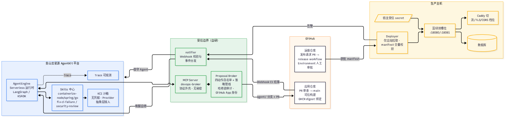

# 项目核心对齐文档（v3：拓扑 B 与有界 MVP）

> 状态：架构决策已采纳，能力待实现/实测。本文为当前概要；运行时、执行底座与实施细节分别以 [agent-runtime.md](agent-runtime.md)、[sandbox-tracks.md](sandbox-tracks.md)、[implementation.md](implementation.md) 为准。`idea.md`、`original.md` 保留历史背景，不作为当前排期与拓扑依据。

## 一、定位与安全目标

同舟 Shipmate 帮助学生团队把一个明确支持的 Web 应用接入可审查、可重复构建、可审批发布、可回滚的工程流程。AI 执行代码改造、真实构建和限定范围的 CI 自修，人类负责代码审查、基础设施变更和发布决定。

**安全目标：未经批准的 Agent 会话不能直接读取生产秘密、访问生产网络或授权发布。** 获批业务代码可能使用应用合法持有的秘密和业务权限，仍需独立审查、最小权限与运行时控制；不宣称物理消除所有泄露。

## 二、已确定的拓扑 B



1. **受信运行时**：AgentEngine + KSADK/LangGraph 运行主循环、模型客户端和固定工具适配器。模型输出、源码、日志与 Skill 均为不可信输入，不能改变工具和身份。
2. **不可信执行区**：SandboxProvider 提供独立 workspace、shell 与文件操作；BuildExecutor 消费不可变快照，在另一临时环境真实构建。不在持凭证的运行时或 Broker 执行仓库代码。
3. **提案边界**：受信适配器经认证调用 MCP/Broker 四动作；Broker 独占 app 仓库的 GitHub App 身份、授权策略与审计。
4. **发布边界**：应用 PR 人工审查、main 可信构建、ops 发布请求与独立 Environment 审批；生产 Deployer 仅出站消费获批 manifest，按 digest 部署。

### 凭证与认证

模型/平台凭证仅给对应受信运行时/调度器，Broker 会话材料仅给固定适配器，App 私钥仅在 Broker，生产凭据仅给对应生产主体。模型上下文、工具结果和不可信沙箱/构建环境不包含这些凭据。

MVP 以 mTLS 服务身份 + 短期会话材料认证适配器，Broker 服务端维护仓库/基线/PR/workspace/snapshot/预算归属。沙箱不直连 Broker、模型或平台管理 API；自报 instance_id 不算实例身份认证。平台 MCP 网关若参与鉴权，须先验证可靠认证转发/终止和会话隔离。

密文变量不等于运行时内存无明文。受信代码与平台基础设施属于可信计算基；不能承诺运行时被攻陷仍无任何风险。

## 三、核心流程

```text
维护者授权任务 → 调度器登记会话/创建独立沙箱
→ 运行时调用 repo.read → Provider 写入源码
→ shell 在沙箱改代码 → 冻结并登记不可变快照
→ sandbox.build → 独立 BuildExecutor 构建与 smoke
→ proposal.submit → 受管分支/PR
→ CI 事件：notifier 验签/去重/排队/关联当前 head
→ 同 session 在预算内读 ci.read、修复并更新 PR
→ 撤销身份、回收构建与沙箱
→ 维护者审查合并 → main 可信构建/隔离推送 → digest/candidate
→ ops 请求与独立审批 → manifest → Deployer 蓝绿部署/恢复
```

不是所有 CI 错误都可自动修复：workflow 权限、平台故障、安全策略拒绝和超出预算的任务输出人工待办；不得修改受保护测试或放开权限取得假绿。

## 四、执行底座可替换，但构建与沙箱独立

| 能力 | 当前选择 | 回退与限制 |
| --- | --- | --- |
| Agent 编排 | AgentEngine 主线 | 本地受信运行时是未来适配，不随沙箱开关自动实现 |
| 工具沙箱 | 优先验证 KCI | 不达标才评估 local；首版只交付一个合格组合 |
| BuildExecutor | 独立临时构建环境 | KCI 构建不满足条件则使用专用节点临时 VM |
| 网络 | 默认拒绝、受信控制端交换源码 | 依赖优先预置；需要下载则受控阶段，不自动开放外网 |
| 验证 | 共享黑盒行为测试 + 后端专属证据 | 有限测试不证明 VM/容器等强度或物理零残留 |

构建节点与生产主机分离。rootless 不能代替 user namespace、PID/挂载、网络、资源和回收验证。snapshot 一致性、跨任务缓存隔离与孤儿清理属于首版要求。

后端预置且满足契约后可配置切换；这不自动替换模型、GitHub/GHCR、MCP/Skills 和会话存储，也不意味着完整离线部署。

## 五、发布与恢复原则

- Broker 不提供 merge/审批工具，Agent 无 GitHub 身份；App 的实际 main 更新能力另由规则与 API 负例验证，不仅看 token 权限名称。
- 发布绑定精确 source_sha、候选 run、image digest、不可变 ops commit、approval run/attempt 与受信 workflow/脚本版本。Environment 要在真实账号验证，不能只写 YAML。
- manifest 有严格 Schema、内容绑定、有效期与单调序号；Release 资产不是天然签名对象。首次接受前篡改、跳过审批 job、旧序号与同 ID 异 hash 均需拒绝。
- Deployer：Validated → Prepared → CandidateReady → Switched → Committed；切流前失败清候选，切流后分类回滚，旧版本也失败进入 ManualRequired。
- journal 每步写意图/结果；原子文件更新之外还需代理运行态、容器身份与真实入口检查。旧镜像保留，已接受事务的本地恢复不依赖云平台在线。
- 应用回滚不撤销数据与外部副作用，不解决单机故障高可用；数据库兼容和备份恢复单独验收。

## 六、MVP 与后置能力

| 首版必须交付 | 后续扩展 |
| --- | --- |
| 一个明确支持的无本地持久状态 HTTP 应用 | 更多语言模板、陌生项目泛化改造 |
| 一个通过门禁的 SandboxProvider + BuildExecutor 组合 | 第二后端、更多隔离机制与性能优化 |
| 一个容器化流程和一种 CI 错误自修 | 五枚云端 Skills、值守 Agent |
| Broker 四动作、独立审批、digest 发布 | UI、更复杂调度与供应链证明 |
| 双槽位、关键崩溃恢复、独立人类告警 | 复杂迁移、多架构、完整离线系统 |
| 持久数据场景的兼容与恢复演练 | 更多数据系统与长期 SLA 观察 |

bootstrap/setup 由有权限的维护者执行，预检 Docker/Compose/Caddy、网络、时间、磁盘及 GitHub 门禁；不会消除管理员授权、账号开通、证书信任与审查判断的责任。CORS/TLS 档位受宿主控制，但不保证任意应用零改动。

## 七、排期与验收

23 天四人实施预算，详见 implementation：D1–3 平台薄链路、认证、真实构建/隔离和审批 PoC；D4–7 单应用最小闭环；D8–15 自修、回滚/崩溃、资源和事件加固；D16–20 负例、故障与证据；D21–23 彩排/缓冲。不把 Agent 首次接入推迟到 D16。

验收目标而非现有成绩：

- 固定 20 次发布至少 19 次成功；定义故障演练有正确结果；回退≤120s（检测失败到旧业务恢复，另计检测延迟）。
- 权限/发布必测负例全部拒绝，重复 manifest 无新增部署副作用，真实身份/网络/文件结果留证。
- 上下文、沙箱/构建区、Trace/日志、镜像层规定凭据样本扫描零命中，不对合法持凭证进程做“零秘密”承诺。
- 一个合格后端组合通过契约门禁，重复/过期事件无重复副作用，明确故障在预算内自修。
- AgentKit 中断不阻塞独立发布、本地恢复、人类告警；模型任务与诊断允许降级。
- 如含持久数据，空白实例实测 RPO≤24h/RTO≤60min；不含则标注不适用。

Trace 用于调用链，审计哈希链和外部锚定用于篡改检测；均不记录模型内部全部思考，也不提供绝对不可篡改保证。

## 八、一句话

**AI 做工程劳动，人掌握审查与发布权；凭证留在对应受信主体，代码执行进入隔离环境，安全与恢复声明由明确范围内的证据支持。**
