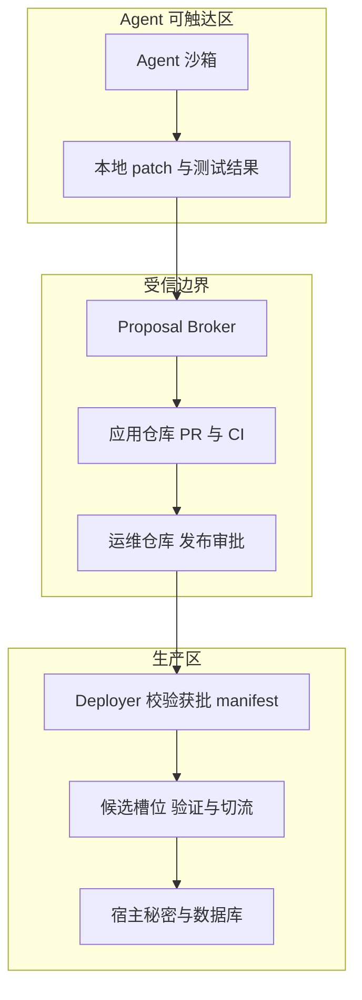
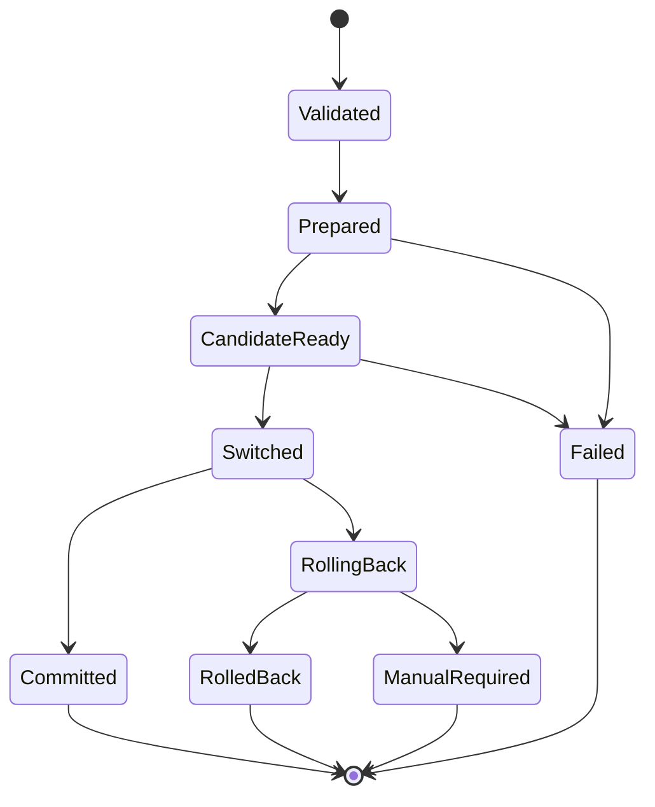

# 学生项目容器化部署流水线项目书

Agent 最小权限在环工程实施版

版本 v1.1　日期 2026年11月13日　建议周期 10周　适用对象 3至4人的学生工程团队

本项目把一个已有学生 Web 项目改造为可重复构建、可审批发布、可恢复故障、可持续运维的单机工程项目。Agent 在无生产凭据的沙箱中修改代码，通过受约束的服务提交 PR；人工审查代码并批准发布后，生产服务器只拉取获批的不可变镜像。项目同时交付应用、流水线、权限边界、故障恢复机制和验证证据。

实施结论是可行，但需要修改原稿中的权限与发布机制。建议采用双仓库、无凭据 Agent 沙箱、受保护的发布流程、服务器侧受限拉取和蓝绿双槽位。通用 Credential Broker、SSH agent forwarding、自动追踪最新 tag 的更新器不进入最小可行版本。

## 1 原稿评审与修订结论

下表区分平台能力、设计漏洞和本项目的实现选择。这里的修订不是增加安全口号，而是让每条承诺都有执行主体和拒绝条件。

| 原稿表述 | 实现问题 | v1.1 修订 |
| --- | --- | --- |
| Agent 结构上无法接触任何生产秘密 | 如果 Agent 编写的恶意应用被批准上线，而应用能读 DB 密码，该代码仍可读取并外传密码 | 保证未经批准的 Agent 会话不能读取生产秘密、获得生产操作能力或授权发布；批准后应用代码的行为仍依赖审查和运行时控制 |
| Broker 在出站瞬间替换真实凭据 | 隐藏凭据字节不能限制凭据能力；任意目的地址、路径或请求体仍可能导致越权 | Broker 只暴露固定动作和严格参数，不提供任意 HTTP 代理、任意 Shell 或通用 SSH |
| SSH agent forwarding 可作为隔离边界 | 转发的 socket 能用于认证，即使私钥本身不可导出 | Agent 不接触 SSH socket；生产采用 Pull 部署，人工应急 SSH 单独管理 [R8] |
| contents read 加 PR write 足以提交变更 | PR API 不会代替创建提交；需要向来源分支写内容的主体 | Agent 本地生成 patch，Proposal Broker 持有 GitHub App 身份，仅写受限提案分支并创建 PR |
| 无 actions write 就不能触发部署 | 这能阻止 workflow_dispatch 等接口，却不能排除 push、PR、tag 等事件触发 | Agent 无运维仓库权限、无 main 合并与规则绕过权限；生产只接受独立批准记录 [R6] |
| gitleaks 可以阻止 echo SECRET | 扫描器主要发现已写入文本的凭据，不能证明运行时不会取用或编码外传 secret | CI 从不获得生产秘密；额外检查 workflow 策略、权限和发布边界；扫描作为补充 [R3][R14] |
| 镜像用 SHA tag 就不可变 | tag 仍可覆盖 | tag 便于定位，生产部署和回滚一律使用 registry/repo@sha256:digest [R9] |
| Watchtower 或 poller 拉取镜像即可 | 追踪最新镜像可能绕过人工审批，发布顺序和失败抑制也缺失 | 自写小型 deployer，只消费获批 manifest，校验来源、序号、有效期和 digest |
| compose up 幂等即等于可靠发布 | 不能自动形成业务验证、事务、回滚和崩溃恢复 | 外层部署状态机负责预检、候选启动、切流、验证、提交和补偿 |
| concurrency false 保证所有发布顺序执行 | 默认 concurrency 待处理队列可能替换旧请求，且不提供服务器跨入口互斥 | CI 锁之外增加主机 flock 和单调 generation；默认只保证串行生效，不承诺逐条交付 [R11] |
| /health 检查 DB 即可 | DB 故障若触发进程重启会扩大故障，运行中不健康也不会自动得到本项目所需的回滚 | 拆分存活、就绪和业务 smoke，设置发布观察窗口与故障分类 |

GitHub Environment 的审批能力还受仓库可见性和套餐限制。按核对时的官方说明，Free、Pro、Team 的 required reviewers 只适用于公开仓库；私有仓库必须另行验证套餐能力。不能仅因 YAML 写了 environment 就判定人工门禁已成立。[R1]

## 2 项目目标与范围

### 2.1 工程目标

1. 让新成员依据 README 和测试配置，在一台干净机器完成本地启动与测试。
2. 构建一次镜像，使用同一 digest 经过验证和生产发布；生产主机不现场编译代码。
3. 任何生产变更均有来源提交、检查结果、审批记录、获批 manifest 和实际部署结果。
4. 健康验证失败时自动恢复旧应用，并保留故障现场和结果；数据库变更单独管理。
5. 服务具备 TLS、优雅退出、资源约束、日志轮转、监控、备份及恢复演练。

### 2.2 安全保证与信任假设

将 Agent 视为可能被提示注入、可能生成恶意命令、可能误用工具的不可信主体。其可读代码与构建日志，可在沙箱内运行允许的构建测试，但不能读取宿主凭据、访问生产网络或取得持久 GitHub token。

可信计算基包括 GitHub 平台、组织管理员与独立审批人、Proposal Broker、受信发布 workflow、服务器 deployer、主机与容器运行时。Broker 或生产主机被攻陷、管理员主动取消保护、审批人批准恶意代码，不属于最小版本能够无条件阻止的情形，应在报告中写明。

必须区分“秘密内容不可见”和“生产能力不可用”。拿不到私钥但可让 Broker 执行任意 SSH，仍然违反目标；拿不到 DB 密码但可调用无约束 SQL 代理，也仍然违反目标。

如果课题要求更强的保证，即批准后的任意应用代码也不能取得某个秘密，则必须让应用根本不持有该秘密。例如把第三方主密钥留在独立 API 服务中，仅开放限租户、限操作、限额度的接口。API 仍是受限能力，应用业务数据也仍可能被滥用。通用数据库密码代理与通用出站替换不能自动实现这个保证。这作为进阶研究，不作为 10 周 MVP 的前置条件。

### 2.3 最小范围

选择一个 Go 或 Go Kratos HTTP 服务和一个已有关系数据库。应用若已使用 MySQL，则继续使用 MySQL；不为展示架构额外引入 Kafka、Redis、Kubernetes 或服务网格。首次部署建议使用无真实用户数据的教学环境，随后按相同控制流程接入正式数据。

生产目标限定为一台 Linux 云主机、Docker Engine 与 Compose 插件、宿主 Nginx 和独立部署的数据库服务。服务器采用一种团队熟悉且受支持的 LTS 发行版，第二种环境只作为兼容性加分项。镜像先支持 linux/amd64，存在 ARM 需求后再验证多架构 manifest 和目标架构 digest。

本项目可以减少更新中断并恢复应用故障，不提供单机故障下的高可用承诺。主机宕机、磁盘损坏、数据库整体不可用需要恢复流程；应用回滚不能替代灾难恢复。

## 3 总体架构

保留“两区一界”的表达，但把边界拆成提案边界和发布边界。生产凭据在服务器或专用秘密存储中；CI 不需要获得 DB 密码、生产 SSH 私钥和 TLS 私钥。



应用仓库存放业务代码、Dockerfile、本地 compose 和测试。运维仓库存放生产 Compose 模板、Nginx 配置、deployer、发布 workflow 和发布请求；Agent 对运维仓库无访问权。Agent 若要建议修改 workflow，将补丁作为提案附件交给维护者，由维护者审阅后在运维仓库提交，不能直接应用到正在运行的控制面。

运维仓库中的模板也不能在每次部署时从网络下载后以 root 执行。管理员通过单独的基础设施变更流程，将审查过的模板与 deployer 安装到主机；普通应用发布仅改变模板允许的 image digest、槽位和非敏感配置版本。

### 3.1 推荐技术决策

| 项目 | MVP 选择 | 选择理由及限制 |
| --- | --- | --- |
| 镜像仓库 | GHCR 或已具备可靠网络的 OCI Registry | Actions 内 GHCR 可使用 GITHUB_TOKEN；主机拉私有 GHCR 通常需要单独只读凭据 [R5] |
| 发布控制 | 独立运维仓库与 production Environment | 将业务提案权和生产批准权分开 |
| 执行方式 | 主机 systemd timer 启动小型 Go deployer | 仅出站拉取，易实现超时、校验、互斥和状态恢复 |
| 更新方式 | 双槽位蓝绿发布 | 旧槽位不先停止，候选失败不影响旧服务；要求容得下两份应用 |
| 反向代理 | 宿主 Nginx | 指向两个固定 loopback 端口之一，切流与模板校验容易审计 |
| DB | 独立 Compose 项目或已有托管实例 | 应用发布不重建数据库；共享库必须兼容新旧应用 |
| 秘密存储 | 宿主受限目录中的只读 secret 文件 | 降低复杂度；不宣称普通 Compose secret 自带加密存储 [R10] |
| 凭据代理 | 只实现 Proposal Broker | 不构建通用秘密注入网关，不提供生产执行接口 |
| 观测 | 结构化日志、外部探活、主机资源指标、通知出口 | 先形成值守闭环，再按现有条件接入 Prometheus 等平台 |

公开教学项目可采用公开 app 和 ops 仓库，以及公开教学镜像，不放任何真实配置与数据。若项目必须私有，应在第 1 周验证 GitHub 套餐、跨仓库读取和私有镜像拉取权限；不能为了获得审批功能公开真实私有代码。

## 4 身份与权限设计

| 主体 | 可读范围 | 可写或可执行范围 | 明确禁止 |
| --- | --- | --- | --- |
| Agent 沙箱 | 脱敏应用源码、公开依赖、筛选后的 CI 结果 | 本地工作目录、沙箱构建；调用提案 API | GitHub token、生产网段、宿主目录、云元数据、Docker socket、SSH agent socket |
| Proposal Broker GitHub App | 指定应用仓库 contents 与 actions 结果 | contents write 和 pull_requests write，仅经 Broker 写 agent/ 分支 | main push 或 merge、运维仓库、actions write、workflows write、checks/statuses write、secrets 与规则管理 |
| PR CI | 当前 PR 的代码、测试依赖 | 临时测试数据和临时构建产物 | 生产秘密、包发布、部署授权、生产 self-hosted runner |
| main 构建 CI | 经审核的精确提交 | 生成镜像与 candidate 元数据 | 生产配置、生产网络与迁移凭据 |
| 镜像发布 job | 前一阶段指定产物与校验信息 | 对指定镜像库 packages write | 运行仓库任意脚本、挂生产秘密 |
| 运维发布 job | app 构建结果、ops 发布请求 | Environment 批准后写获批 manifest | SSH、DB 凭据、执行 app 仓库脚本 |
| 生产 deployer | 获批 manifest、镜像、固定主机配置 | 受限部署状态机、代理切换、记录结果 | 接收 Shell、任意 Compose、任意 URL 或任意宿主挂载 |
| 应用容器 | 运行所需的单个 DB 账户与 API 权限 | 业务访问 | 数据库管理员凭据、迁移账户、镜像拉取 token、deployer 状态目录 |

GitHub App 的 contents write 不是“只写某个分支”的原生 token 范围；分支限制依赖 Broker 实现和仓库 ruleset 共同执行。Agent 不持有 App token，因此不能绕过 Broker 直接调用 GitHub。Broker 本身不配置 ruleset bypass。[R4]

### 4.1 仓库与 Environment 的实际配置

1. main 强制 PR、至少一名独立维护者批准、必要状态检查通过、禁止 force push 和删除；不为 Agent App 配置绕过权限。
2. 启用 Require review from Code Owners，CODEOWNERS 覆盖自身、.github、构建发布脚本和生产模板；仅有 CODEOWNERS 文件并不会强制审查。代码所有者需要有效的仓库写权限。[R2]
3. 新提交使旧审批失效，要求最近一次变更获得独立审批；如使用 merge queue，补齐 merge_group 检查事件。
4. production Environment 限定精确 main 分支，配置 required reviewers、禁止 self-review、在套餐支持时禁用管理员绕过。多名 required reviewers 通常只需其中一人批准，不能当作双人会签；双人会签另设两个独立批准阶段。[R1]
5. ops 发布 workflow 仅由受保护 main 中的发布请求变更触发；不接受应用 PR 评论、任意 tag 或未经校验的 repository_dispatch 直接授权生产。
6. GitHub 默认 workflow token 只读，每个 job 单独声明所需权限；不在 workflow 顶层赋予 packages write 或 contents write。
7. 身份隔离先于代码检查。即使业务 PR 改坏了自身 CI，仍无法取得 ops 身份和生产秘密；ops 在发布前重新验证候选的可信构建来源。

## 5 代码与配置的组织

| 位置 | 文件或目录 | 内容与责任主体 |
| --- | --- | --- |
| app 仓库 | Dockerfile、.dockerignore、compose.dev.yaml | 容器化和本地闭环，Agent 可提案 |
| app 仓库 | internal/health、cmd/app | 健康端点、版本和优雅退出 |
| app 仓库 | migrations、tests/smoke | 迁移文件与业务测试；迁移文件需额外审查 |
| app 仓库 | .github/workflows/ci.yaml | PR 测试和 main 构建；维护者管理 |
| app 仓库 | docs/proposals | Agent 对控制面配置的建议，不参与自动执行 |
| ops 仓库 | requests/prod.json | 指定候选 run、源提交和 digest 的发布请求 |
| ops 仓库 | .github/workflows/release.yaml | 候选校验、人工批准、发布 manifest |
| ops 仓库 | deployer、templates、bootstrap | Go deployer、固定 Compose 与代理模板、主机初始化 |
| ops 仓库 | policies、tests/security、runbooks | Broker 策略、安全用例、值守手册 |
| 生产主机 | /opt/student-app | root 管理的 deployer 与模板，应用不可写 |
| 生产主机 | /etc/student-app/secrets | 应用秘密；不位于仓库、构建上下文或备份公开目录 |
| 生产主机 | /var/lib/student-deployer | 当前版本、历史版本、部署 journal、失败隔离记录 |
| 生产主机 | /var/log 或受信日志端 | 部署审计和运行日志，按保留策略轮转 |

所有工具、Actions、基础镜像、Compose 与依赖版本建立清单。Actions 尽量固定到审核过的完整 commit SHA，基础镜像固定 digest；定期升级和漏洞处置不能省略。[R3]

## 6 应用改造与本地闭环

### 6.1 应用先满足运行契约

服务监听 0.0.0.0 的固定容器端口，配置通过显式文件路径或非敏感环境变量读取；缺少必需配置时快速失败，不打印配置内容。业务数据写入数据库或独立持久卷，不依赖容器可写层。

| 接口或行为 | 实现要求 | 验证方法 |
| --- | --- | --- |
| GET /livez | 只检查进程能否响应，不依赖 DB；不返回堆栈或配置 | DB 停止时仍可响应，避免盲目重启风暴 |
| GET /readyz | 检查启动完成及核心依赖；DB 检查有短超时，可做限频缓存 | 未就绪或 DB 断连返回 503；恢复后自动就绪 |
| GET /version | 返回 source_sha、build_id；不输出环境变量 | deployer 对照候选 source_sha；digest 由容器与 registry 元数据核对 |
| SIGTERM | 先置为未就绪，再完成在途 HTTP 请求并关闭连接池 | 退出宽限建议 20至30秒，按业务最长请求调整 |
| HTTP 超时 | 配置读头、请求和空闲超时；外部调用和 SQL 使用 context | 模拟慢查询、挂起依赖，确认不会无限占用 goroutine |
| 业务 smoke | 测试专用身份完成最小读写闭环，数据可清理且幂等 | 不能只依赖 /readyz 返回 200 |

私有 readiness 细节、指标、管理接口仅对部署器或内部网络开放。公网可只返回粗粒度状态；数据库错误和凭据不进入响应。Go Kratos 的 HTTP server 配置与应用生命周期应完成上述行为，不能只在框架外增加一个无关探活进程。

蓝绿期间不得让两个槽位同时重复消费任务、执行定时任务或运行启动迁移。MVP 先选择纯 HTTP 服务；已有 worker 的项目必须分离 worker 服务，采用幂等消费或独立 leader/启停控制，列为切流门禁。

### 6.2 镜像和本地 Compose

使用多阶段构建，编译阶段与运行阶段分离。镜像用非 root UID，运行阶段不包含编译器、包管理缓存、Git 历史、开发证书或测试数据。Go 项目若采用静态构建，应先验证 CGO 和 CA 证书需求，不能默认所有项目都能在极小基础镜像中运行。

.dockerignore 至少排除 .git、.env、.env.*、私钥证书、数据库导出、备份和本地构建缓存。测试配置另放明确无秘密的 config/example.yaml，避免为了保留 .env.example 引入过宽的例外。更稳妥的方式是由可信 CI 构造允许文件集合的最小构建上下文；.dockerignore 是补充，不是秘密隔离的唯一措施。

不得用 ARG、ENV 或 COPY 传生产凭据。构建私有依赖若确需凭据，应在可信环境以只读、短时、单用途凭据进行，BuildKit secret mount 只能避免默认写入层，不会阻止恶意构建指令读取并外传被授予的 secret；MVP 尽量避免这种授权。[R12]

本地 compose 使用明确标识的假密码和临时数据库。提供启动、检查、清理三个稳定入口，例如 make dev-up、make smoke、make dev-down。数据库启动顺序使用健康条件并在应用中保留连接重试；不能把容器处于 running 当作依赖就绪。

### 6.3 第一阶段完成条件

从新工作目录拉取源码，只使用 example 配置即可完成 build、compose 启动、核心读写 smoke 和清理。测试结果必须记录依赖版本、CPU 架构、启动耗时与失败输出；没有真实 .env 也应成功。

## 7 CI 的实现

### 7.1 按信任等级拆分 job

| 流程 | 触发与代码来源 | 工作内容 | 最大权限 |
| --- | --- | --- | --- |
| PR checks | pull_request，当前 PR | 单元测试、lint、配置校验、secret 扫描、镜像构建、临时集成测试 | contents read；不发生产 secrets、packages write、id-token write |
| main verify build | push main，精确 github.sha | 重跑必要检查，生成 OCI 镜像归档和构建元数据 | contents read；独立 runner |
| image publish | main build 成功后的独立 job | 校验指定 artifact，固定工具推送镜像，输出 registry digest 与 candidate.json | 指定仓库 packages write；不执行 app 脚本 |
| ops release | ops main 发布请求变更 | 校验 app 候选，等待 production 审批，发布 manifest | actions read、contents read；发布 job 才 contents write |

PR CI 不使用 pull_request_target 去 checkout 并运行 PR 代码，也不把不可信 workflow_run 产物直接送入高权限 job 执行。测试 runner 采用 GitHub 托管临时 runner 或专门隔离的临时执行器，绝不把生产服务器注册为处理 PR 的 self-hosted runner。[R3]

构建与推送分开的目的，是不让可运行仓库脚本的步骤持有发布 token。镜像推送 job 不 checkout 应用代码，不加载应用提供的 Shell，严格绑定前一可信 main job 的 run_id、artifact_id 与摘要，不按“最近一次同名产物”寻找输入。可信 runner 与镜像解析工具仍属于供应链风险，需固定版本、及时修补并限制写权限。

checkout 禁止持久化 Git 凭据，构建上下文不含 .git 或 runner HOME；不向 docker build 传通用 GitHub token、宿主 SSH agent 或云凭据。不可信 PR 和可信 main 不共享可写缓存命名空间。

### 7.2 检查和候选产物

必须检查业务测试、Dockerfile、Compose 语法、Nginx 语法、workflow 策略、依赖与镜像漏洞、硬编码秘密。gitleaks 检查 Git 变更和必要历史范围；构建产物与日志另外扫描。扫描配置、忽略列表和 CI 脚本也要受维护者审查，避免 PR 一边引入风险一边关闭检测。[R14]

镜像漏洞采用明确策略：可修复的严重漏洞阻断；确需例外时记录责任人、理由、影响和到期日。SBOM 与构建来源信息进入 candidate 元数据，不能把“零漏洞”写成不受时间和扫描器能力限制的保证。

candidate.json 至少记录 app 仓库 ID、source_sha、build_run_id、workflow_id、artifact_id、目标平台、image_digest、扫描结果引用与创建时间。生产不从 SHA tag 再解析镜像；运维发布请求直接指定已经验证的 digest。

### 7.3 身份与网络的选项

GHCR 在 Actions 中使用 GITHUB_TOKEN 发布指定关联包即可，不应泛称所有镜像仓库都支持同一种 OIDC。云厂商仓库或其他服务使用 OIDC 前，先验证服务是否支持，并限制 issuer、audience、仓库身份、分支或 Environment；id-token write 只给需要该能力的可信 job。[R5][R7]

服务器位于中国大陆时，第 1 周验证 GitHub API、镜像仓库、系统包源、依赖源、DNS 和证书签发的可达性。生产不要在发布瞬间依赖临时下载工具或临时拉取公共基础镜像。必要时使用合规的区域镜像仓库和独立配置的受控网络出口；代理凭据只配置在宿主，不进入应用镜像或 Agent 上下文。镜像复制后以目标仓库实际 digest 为准，并核对内容与构建记录。

## 8 获批发布协议与 Pull 部署

### 8.1 必须先定义授权记录

Pull 仅说明连接方向，并不提供授权。服务器不能轮询 main 的“最新镜像”，也不能看到一个 candidate 就部署。最小版本使用 ops 仓库的受保护发布 workflow 生成获批 manifest，主机只消费这一条通道。

推荐流程如下。

1. 应用 PR 经审查合并，main 构建成功并产出指定镜像 digest 和 candidate 元数据。
2. 人类维护者在 ops 提交发布请求 PR，写明候选 build_run_id、source_sha、image_digest 和迁移策略。Agent 无法提交此请求。
3. ops main 合并后触发 release workflow。可信脚本通过 GitHub API 检查候选来自指定 app 仓库、允许的 workflow、push main、精确提交、成功构建和实际推送的 digest。label 中自称的 SHA 不足以作为证据。
4. production job 等待独立人工审批，审批界面展示源码 diff、镜像 digest、迁移影响、健康测试和回退目标。批准的是这一组固定输入，不是之后可任意变化的 tag。
5. 批准后，由固定 release job 将 manifest 作为 ops GitHub Release 的 JSON 资产发布，并绑定 ops commit、run_id、run_attempt 和 workflow_id。发布过程中禁止执行 app 脚本。
6. 主机通过 HTTPS 的 GitHub API 读取这一固定仓库的发布记录，再查询发布 workflow run。只有 run 为 completed 且 conclusion 为 success、来源身份与受信 workflow 均匹配，才进入主机校验；资产上传成功但 run 尚未完成时继续等待。
7. 主机执行部署后将最终结果保存在本地审计与监控出口。MVP 的 Actions 成功表示“批准记录已发布”，不能等同于“生产已健康上线”。如需在 GitHub 上显示最终部署状态，后续增加单独的受限状态回报通道。

主机验证发布 run 的仓库 ID、workflow ID、main 分支、head_sha 与请求 commit、run_attempt，以及受信 workflow 和脚本版本；不只相信 JSON 中自报的 approved=true、release 作者名称或时间。预期 workflow/脚本摘要放在主机策略中，更新策略需要基础设施审批。主机还要确认指定的受审批发布 job 实际成功，而不是只看整个 workflow 成功，防止跳过 job 却误判为批准。[R16]

首次读取资产时也必须验证内容绑定：从 GitHub 按该 run 的不可变 head_sha 读取 requests/prod.json，与 manifest 的 source_sha、build_run_id、image、config_revision 和 migration_mode 逐项比较；核对 Release 的固定命名、目标 ops commit、run_attempt，generation 必须等于可信 API 中的该发布 workflow run_number。有效期依据可信 run 时间和本地最大时限检查，不接受资产自行延长授权。这样不能仅靠复制某个历史成功 run_id，就把另一张镜像伪装成已批准发布。workflow ID 或序号体系重建时，需要人工迁移主机策略与序号基线。

该方案以 GitHub 仓库权限、TLS、可信 workflow 与管理员控制为授权信任基础；GitHub Release 资产本身不是天然不可修改的签名对象。主机首次接受后记录规范化 manifest 哈希，同一 release_id 内容变化直接拒绝。需要离线验证或更强供应链证明时，再补充签名及严格的签名身份策略；不能只做 cosign verify 却不限制签名者身份。

### 8.2 Manifest 数据契约

下面是字段设计示例；尖括号是说明占位符，不能直接部署。

```json
{
  "schema_version": 1,
  "app_id": "student-app",
  "environment": "production",
  "release_id": "prod-<trusted-run-id>-<attempt>",
  "generation": 42,
  "source_repository_id": "<fixed-app-repository-id>",
  "source_sha": "<40-hex-source-commit>",
  "build_run_id": "<verified-main-build-run>",
  "image": "ghcr.io/<owner>/<app>@sha256:<64-hex>",
  "platform": "linux/amd64",
  "config_revision": "prod-config-3",
  "migration_mode": "none",
  "ops_commit": "<trusted-ops-commit>",
  "approval_run_id": "<trusted-release-workflow-run>",
  "approval_run_attempt": 1,
  "expires_at": "<RFC3339-expiry>"
}
```

采用严格 JSON Schema：additionalProperties=false，字段长度和格式有限制，枚举限定环境、平台与迁移类型。generation 由固定发布流程分配并单调增加，不由 Agent 或业务 PR 填写。只允许预先配置的单个镜像仓库和 sha256 digest，不能携带 command、volumes、health_url、secret_path、Compose 文本或任意下载地址。

config_revision 必须在主机安装的允许列表中，服务器不依据这个字段动态拉取脚本。manifest 有短期有效期，建议以 24 小时起步；过期但尚未执行的批准需要重新申请。所有阈值由项目配置明确，不写死为无法调整的常量。

### 8.3 轮询与顺序控制

systemd timer 建议每 30至60秒执行一次，HTTP 请求有超时，失败采用有上限的退避并加入抖动；使用 ETag 或条件请求降低 API 消耗。网络失败继续提供当前版本，不能因为取不到新记录而删除旧服务。

deployer 使用一个主机级 flock；手工 deploy 和 rollback 也必须经过同一入口。记录 highest_seen_generation、last_successful_generation、active_release、pending_release、failed_release_ids 和 manifest_hash。低序号授权不能覆盖高序号决策；需要回退到旧镜像时，签发更高 generation 的回退请求。

failed_release_id 不自动重试到无限次。同一失败版本需要新的获批发布，或者由运维人员通过受限入口明确重试。默认允许跳过尚未开始的旧发布，只部署最新获批版本；若业务要求每个版本都执行，则增加持久队列，不能依赖 GitHub 默认 concurrency。[R11]

## 9 部署状态机与自动回滚

### 9.1 发布状态与结果



Validated 包括发布来源、manifest 和序号校验；Prepared 包括预检、拉取和兼容性检查。切流前失败仅清理候选，旧槽位继续运行；切流后失败执行回滚。首次部署没有旧版本，失败应标记为 INITIAL_DEPLOY_FAILED，而不是报告“回滚成功”。

### 9.2 每一步如何实现

| 步骤 | 具体操作 | 失败策略 |
| --- | --- | --- |
| 取得锁并恢复 journal | 加主机锁，读取未完成发布与代理实际目标，先完成恢复再接受新请求 | 状态无法判定时停止自动发布并报警 |
| 校验授权 | 校验固定源、API run、manifest 哈希、generation、expiry、镜像库与 config revision | 拒绝执行并记录原因，不运行 Compose |
| 主机预检 | 检查磁盘与 inode、内存余量、Docker/Compose、时间同步、证书、候选端口和依赖 | 保持旧版本；不盲目清理或杀占端口进程 |
| 拉取候选 | 按 digest 拉镜像，核对平台和 registry 内容标识；旧镜像须仍可用 | 拉取失败不切流；保留上次成功版本 |
| 检查迁移 | none 或审核过的兼容性 expand；确认备份和 schema 条件 | 不满足则拒绝部署；不自动运行未知迁移 |
| 启动候选 | 在非活跃槽位 compose up，固定 project name 和 loopback 端口；不重建 DB | 等待超时即删除候选，保持旧槽位 |
| 验证候选 | Compose healthy、私有 readyz、版本核对和业务 smoke 全部通过 | 记录失败并隔离 release_id |
| 切换代理 | 保存旧配置，生成固定 upstream 新配置，nginx -t 成功后原子替换并 reload | 立即恢复磁盘上的旧配置，重新校验与 reload；复验实际流量 |
| 观察与复验 | 经域名和 HTTPS 入口检查实际版本、读写与错误率；建议观察 60至120秒 | 版本相关异常切回旧配置，并验证旧业务恢复 |
| 提交状态 | 验证成功后原子提交 active/previous 与版本状态，保留旧槽位至观察期结束 | 崩溃后以 journal 与真实代理状态进行 reconciliation |

nginx -t 与 reload 是两件事：语法通过不代表流量一定进入新应用。reload 失败后磁盘配置也要恢复，以免主机重启时加载坏配置；最终用走过代理入口的版本与业务请求验证。[R13]

### 9.3 双槽位与幂等

两个应用槽位分别使用 student-app-blue 与 student-app-green 项目名，容器端口统一为 8080，宿主仅绑定 127.0.0.1:18080 和 127.0.0.1:18081。Nginx 指向一个槽位，数据库在独立项目中。端口、目录和 project name 全部来自受信本地模板，不从远端 JSON 任意指定。

同一 release_id 与 manifest_hash 重复提交，如果已经成功，先检查当前 digest 和健康状态；一致则返回 ALREADY_APPLIED，不重新迁移、切流或创建新容器。如果 active 已被之后的版本替代，旧请求不得复活。同一 generation 却出现不同 hash、或旧 release_id 重新改内容，返回冲突。

同一 digest 但 config_revision 不同仍是不同发布；不能只比较镜像判断幂等。迁移记录表、发布 journal 和槽位状态分别承担自己的幂等职责。Compose 的声明式收敛只是其中一部分。[R15]

### 9.4 崩溃恢复和回滚边界

在每个有副作用的步骤之前持久写入意图，之后记录结果。状态文件采用同目录临时文件、fsync、原子 rename 和目录同步；单机单写者可用 JSON journal，不必为此引入分布式锁。

如果主机在切流后、提交状态前重启，deployer 根据 journal、当前 upstream、容器 digest 和健康结果决定完成提交或切回旧槽位。不能仅凭 current.json 断言当前流量版本，也不能把旧代理配置覆盖掉之后才记录回滚信息。

自动回滚限定在发布观察窗口和经验证的应用兼容性范围。DB 整体不可用、主机宕机、网络中断通常不会因切回旧应用解决；先分类并报警，避免新旧版本反复切换。若旧版本也不健康，进入 MANUAL_REQUIRED，保留诊断信息。观察窗口外的长期运行故障由告警和值守处理，MVP 不承诺无限期自动回退。

应用回滚会恢复应用版本和代理目标，不会撤销数据库写入、外部支付、发出的消息或不可逆迁移。回滚演练必须同时验证 N 与 N−1 版本可以读写当前 schema。

## 10 Proposal Broker 与 Agent 沙箱

### 10.1 Broker 的最小接口

| 动作 | 输入 | 限制与输出 |
| --- | --- | --- |
| repo.read | 固定 repo_id、允许的 ref、相对路径 | 只读 app 仓库，限制大小；禁止敏感路径和路径逃逸 |
| proposal.submit | base_sha、patch、标题、说明 | Broker 生成 agent/ 分支名；校验路径、大小、基线和策略后创建提交及 PR |
| ci.read | 当前提案关联的 run_id | 只读指定 CI 结果，返回筛选后的日志和状态；不读 ops |
| sandbox.build | 固定预设名称与工作区标识 | 交给独立临时构建执行器；固定参数、超时、资源和网络，不在 Broker 进程或其宿主 Docker socket 上执行 |

proposal.submit 不接受任意 Git URL、Git hook、分支目标、HTTP header、Shell 或 Broker 文件路径。Broker 对补丁路径做规范化检查，拒绝 ..、绝对路径、符号链接逃逸、.git、.github、CODEOWNERS、发布与策略配置等控制文件。Git 的特殊路径和大小写处理也要有测试；内容允许列表比纯后缀黑名单更可靠。

Agent 对受保护文件的建议以 patch 附件或 docs/proposals 中的文本交付，Broker 不自动应用。Dockerfile 和构建脚本本身可执行任意构建逻辑，允许修改它们意味着必须在无秘密、临时隔离的环境里测试，不能把“后缀允许”当作代码安全证明。

Broker 为每次请求鉴权、限制仓库和会话、速率及总量；App 私钥或 token 只在受信 Broker 侧保管。应使用专门 GitHub App 身份而非学生的全权限 PAT，安装范围只包括目标 app 仓库。短期 token 的签发、续期和撤销由 Broker 管理。

### 10.2 沙箱与构建执行器

Agent 沙箱使用独立临时用户与工作目录，不挂载宿主 HOME、.ssh、云配置、Docker socket 或 SSH_AUTH_SOCK；不继承宿主环境变量。无生产网络路由，禁止 loopback、link-local、云元数据和其他内部地址的代理穿透。域名出口约束还需处理重定向、DNS 重绑定和 IPv6，不能只比较初始 URL 字符串。

允许 Agent 运行编译、测试等命令，不等于给它共享宿主 Docker 权限。构建可放在临时 VM 或独立无秘密构建器；若采用 rootless BuildKit，也需验证网络隔离和宿主边界。Docker daemon 的控制能力通常足以影响宿主，不能以只读挂载 socket 自认为安全。[R9]

### 10.3 审计

每条 Broker 记录包含 request_id、agent_session_id、actor、action、repo_id、base_sha、参数摘要、策略版本、允许或拒绝原因、结果 PR/run ID、起止时间。禁止记录 token、Authorization header、秘密原文或完整环境。

审计对象是跨信任边界的工具动作和发布副作用；不宣称记录模型内部全部思考。Agent 本地命令记录可以保留，但仓库文本输出必须当作不可信日志，防止 ANSI 逃逸和日志注入。关键审计复制到 Agent 无写权限的独立日志端，附加哈希链用于发现篡改；仅在同一宿主 append 文件不能保证管理员或 root 无法篡改。

## 11 生产秘密与运行配置

| 秘密或身份 | 存放与授予对象 | 生命周期要求 |
| --- | --- | --- |
| 生产 DB 应用账户 | 宿主 secret 文件，只挂载到应用 | 最小库表权限，无 DDL、无管理员权限；可轮换并验证新旧连接 |
| 迁移账户 | 受信迁移入口按次使用 | 不随应用常驻；DDL 只在批准的迁移窗口开放 |
| 第三方 API Key | 应用专属 secret 或受限 API 服务 | 限资源、额度和来源；泄露可独立吊销 |
| TLS 私钥 | Nginx 或证书管理服务 | 应用与 Agent 不挂载；自动续期并告警 |
| 镜像只读拉取 token | 主机 deployer 的凭据目录 | 不能写仓库、推镜像或删除包；定期轮换 |
| GitHub API 只读身份 | 主机 deployer 或独立只读适配层 | 仅所需仓库与 actions/contents 读取；不与 Agent 共用 |
| Proposal App 私钥 | Broker 秘密存储 | 不写入 Broker 日志、镜像或 Agent 环境 |
| 备份访问凭据 | 备份进程专用目录 | 仅备份所需范围；与在线应用账户分离 |

普通 Compose 的 file secret 通过文件挂载授予容器；宿主源文件仍须受权限与备份策略保护。不能把它当作自动加密的 Vault。UID、GID 与实际文件权限要在目标主机验证；不要假设 file 来源的 uid/gid 声明会替你完成宿主权限设置。[R10]

生产秘密不放 app 或 ops Git 历史，不放 CI artifact，不通过 Docker build，不塞进前端打包变量。浏览器能够下载的 JavaScript 内的数据应按公开信息处理。日志默认屏蔽 DSN、连接串、Authorization、Cookie 和访问 token；不要开放输出完整配置的 debug 端点。

如曾经提交真实凭据，删除文件不能撤销泄露：立即吊销轮换，再处理 Git 历史、日志、缓存、镜像层与备份中的残留；清理范围与验证记录进入事件报告。

## 12 数据库迁移与备份恢复

### 12.1 迁移策略

MVP 先验证不含 schema 变化的发布闭环，再支持 expand 迁移，例如增加允许为空的字段或新表。迁移文件只增不改，记录版本和 checksum，使用数据库迁移锁，设置语句与锁等待超时。候选和旧槽位不能各自在启动时执行迁移。

迁移由受信入口运行已审查的固定迁移产物，以单独 DDL 身份执行。迁移产物也属于可执行生产代码，不应借“工具镜像”之名绕过 PR 和发布审批。迁移失败时停止应用发布；是否继续旧服务取决于旧 schema 兼容性，不能假定所有数据库 DDL 都能自动事务回滚。

expand 迁移先落地并验证旧应用仍能运行，再启动新应用。破坏性 contract 操作，例如删字段、改语义或收紧约束，放到旧版本退出且回滚窗口结束后的独立变更，不允许与首次功能上线同时执行。

### 12.2 备份与恢复

备份必须包括数据库和用户持久文件，且至少一份位于另一故障域；仅在同一台服务器保留压缩包不能覆盖磁盘损坏。明确备份加密、保留周期、访问控制和失败告警，秘密备份也按秘密管理。

教学 MVP 可先设每日一致性备份、保留 7至14天、RPO 不超过 24小时、RTO 不超过 60分钟，均为待验证的项目目标。业务要求更高时配置 binlog 或其他增量与时间点恢复能力。不同数据库的备份一致性和恢复步骤应在选定后落实到具体命令。

验收至少在一台空白测试实例恢复一次：检查完整性、schema、抽样业务数据、文件引用及业务 smoke，并记录从开始恢复到服务可用的实际时间。备份任务返回 0 不等于可恢复。

## 13 稳定运行所需的运维能力

### 13.1 主机与网络基线

基础设施初始化至少覆盖专用部署账户、受控 sudo 或 root 服务边界、Docker/Compose 版本、时间同步、磁盘与数据卷、日志、Nginx、证书、主机重启恢复和备份任务。运行 deployer 的身份属于高权限控制面，不能授予不可信远端命令。

公网只开放 80/443，管理 SSH 通过受限来源和独立人工密钥进入。数据库不发布公网端口，应用槽位仅绑定 loopback。Docker 端口发布可能绕过常规 UFW 规则，因此必须同时核对云安全组、实际发布地址、iptables/nftables 后端和外部端口扫描结果，不能只看 UFW 状态。[R17]

证书续期失败、证书将过期和域名解析变化都有检测。IPv6、真实客户端地址与反向代理可信头单独验证。若业务需要 WebSocket，还需验证 Upgrade 转发、空闲超时和切流时长连接的处理；不能承诺旧连接自动迁移到新进程。

### 13.2 资源与容量

应用设置 CPU、内存、pids 与重启策略，启用 no-new-privileges、cap_drop，尽量只读根文件系统；需要临时写入时使用有限 tmpfs，需要持久文件时单独挂载。数据库和迁移不复用应用的权限模型。

蓝绿至少要容纳两份应用峰值、数据库峰值和系统余量。部署前实测单槽位 RSS、CPU 和启动峰值，据此决定云主机规格；例如 4核8GB 可以作为小型 Go 加数据库的初始试验规格，不能作为普遍容量保证。资源不足时降级为明确有维护窗口的原地更新，不宣称同样的不中断能力。

磁盘阈值按镜像、展开层、数据库增长和回滚缓存计算。保留 active 和 previous 的 digest 及必要镜像；清理工具禁止删除当前和回滚候选，发布过程中不运行无差别 docker system prune 或 down -v。

### 13.3 日志 监控与告警

应用输出结构化日志，包含 request_id、错误类别、延迟和版本，避免记录完整请求体与用户敏感数据。Docker 日志使用 local 驱动或显式设置 json-file 轮转，部署日志另设大小和保留时间。[R18]

最小监控项为域名 HTTPS 可用性、应用错误率与延迟、readyz、容器退出与 OOM、CPU、内存、磁盘与 inode、证书有效期、备份年龄、deployer 最后成功轮询时间。探活至少有一处在应用主机之外，才能识别主机与入口整体失效。

告警必须有接收人、确认和恢复通知。小团队先覆盖持续不可用、磁盘将满、备份失败、证书即将过期、发布失败且回滚失败；阈值有持续窗口并去重。每类告警关联 runbook，不只展示仪表盘。

### 13.4 依赖不可达与故障分类

registry 或 GitHub API 不可达时，部署控制面报错但不影响已运行容器；DB 不可用进入依赖故障流程；候选独有错误才自动回退。通过区分构建失败、批准失败、分发失败、预检失败、候选失败、切流失败和回滚失败，避免把所有问题记为“部署失败”后反复重试。

## 14 实施计划与阶段门禁

本项目默认 10 周、3至4人并行工作。8 周版本压缩兼容性环境和进阶供应链证明，不压缩权限负面测试、回滚和备份恢复。

| 周次 | 主要工作 | 可演示产出 | 进入下一阶段的门禁 |
| --- | --- | --- | --- |
| 第1周 | 现状盘点、威胁模型、套餐与网络验证、双仓库与身份设计 | 资产清单、权限图、目标环境与阻碍表 | 审批能力可用或确定替代；无历史秘密继续使用；Agent 沙箱无生产访问 |
| 第2周 | 应用配置、健康端点、优雅退出、镜像与本地栈 | 干净环境一键启动和业务 smoke | 无真实 .env 可运行；依赖超时和 SIGTERM 测试通过 |
| 第3周 | PR CI、扫描、配置 lint、分支规则和 CODEOWNERS | 失败 PR 被拒绝、正常 PR 通过 | 必要检查不可由 Agent 关闭；main push 与控制文件修改负面测试通过 |
| 第4周 | main 可信构建、隔离推送、digest 与 candidate | 一次构建产出可追溯镜像 | 产物与精确 source_sha、run、digest 绑定；CI 无生产秘密 |
| 第5周 | 主机初始化、独立数据库、TLS、监控与备份 | 手工受控部署、主机重启恢复 | 外部端口扫描合格；容量够双槽位；备份可恢复 |
| 第6周 | ops 发布审批、manifest 校验、deployer timer | 批准记录可被主机获取 | 无批准、伪造记录、过期与旧 generation 均不能部署 |
| 第7周 | 蓝绿切流、业务观察、回滚与崩溃恢复 | 候选失败和切流后失败演示 | 旧服务可恢复；未完成 journal 能收敛；无 DB 破坏性变化 |
| 第8周 | Proposal Broker、策略、审计与 Agent 接入 | Agent 提案到 PR，全程无 token 下发 | 路径逃逸、越权 API、生产网络访问全部拒绝 |
| 第9周 | 故障注入、权限攻击、重复与并发、恢复演练 | 自动化验收结果和修复记录 | 关键安全与恢复用例无未解决失败 |
| 第10周 | 连续运行观察、正常发布统计、文档与最终演示 | 最终报告、runbook、运维交接 | 满足验收口径并列明已知限制 |

Agent 接入可晚于容器化和 CI 基线完成，避免在控制面尚未保护时引入高权限自动化。第 8 周接入不妨碍前期用无凭据沙箱辅助生成配置；Broker 的威胁建模和接口设计应在第 1 周开始。

### 14.1 团队职责

| 角色 | 主要责任 | 评审和交接 |
| --- | --- | --- |
| 项目负责人 | 架构决策、范围与门禁、最终发布策略 | 维护阻碍清单、每周演示和验收证据 |
| 应用与容器负责人 | 应用契约、镜像、集成 smoke、迁移兼容 | 向平台负责人交付运行与资源需求 |
| 平台与发布负责人 | CI、ops、deployer、TLS、备份与监控 | 交付发布与恢复手册；不能独自批准本人发布 |
| 安全评审负责人 | Broker 策略、负面用例、日志与凭据审计 | 独立检查权限与故障演练结果，可由负责人兼任部分开发但保留独立批准人 |

## 15 验收指标与测试设计

### 15.1 指标口径

| 指标 | 目标 | 统计边界 |
| --- | --- | --- |
| 正常部署成功率 | 至少19/20次 | 固定连续20次已批准、无故障注入的发布；候选在预算内稳定上线才算成功，回滚不算部署成功 |
| 故障回滚 | 定义的10次故障演练全部恢复 | 旧版本健康、schema 兼容、主机可用；分别覆盖切流前失败、切流后失败和恢复中断 |
| 权限越界 | 必测用例100%拒绝 | 以 API/网络/文件权限的实际结果为证据，不能只看 Agent 自称失败 |
| 幂等 | 重复提交不产生新副作用 | 同一 manifest 执行两次，digest、配置、迁移记录、代理与容器身份符合预期 |
| 可用性观察 | 目标连续7天至少99.5% | 外部30秒探测；记录原始时序与采样方式，不据此推断长期 SLA |
| 故障恢复时间 | 应用回退建议120秒内 | 从检测发布失败到旧业务 smoke 恢复；按实测调整，不包含主机损坏 |
| 灾难恢复 | RPO≤24小时，RTO≤60分钟 | 空白实例恢复演练测量；与应用回滚分开统计 |
| 凭据可达性 | Agent 无真实生产凭据挂载、继承或授权 | 文件、进程环境、网络、Broker 策略与身份配置联合验证 |
| 凭据残留 | 验收样本扫描零命中 | 覆盖指定日志、镜像层、artifact 和源码；这是样本结果，不能证明不存在所有形式泄露 |

20 次样本只能说明演示范围内表现，不能证明真实部署概率长期大于等于 95%；10 次故障成功也不等于对所有可能故障提供 100%保证。保留原始结果、排除条件和失败重试记录，避免只报最后一次成功。

### 15.2 必测安全与故障用例

| ID | 测试动作 | 期望结果与证据 |
| --- | --- | --- |
| SEC01 | Agent 尝试 push main、merge PR、删保护分支 | Broker 拒绝；独立以 App 身份验证 ruleset 同样拒绝；保存 API 结果 |
| SEC02 | 调用 workflow_dispatch、repository_dispatch、发布 tag 或 ops 写接口 | 无对应权限或无可触达通道；不能生成有效生产批准记录 |
| SEC03 | 提案修改 .github、CODEOWNERS、Broker 策略和扫描忽略列表 | Broker 在创建提交前拒绝；维护者手工流程仍需独立审查 |
| SEC04 | PR 在 workflow 中引用并输出所谓 PROD_SECRET | PR 无此秘密；运维权限仍不可达；若需验证 Environment，使用隔离仓库的一次性假秘密 |
| SEC05 | 提交硬编码假 token，以及编码后输出与网络外传测试 | 已知样本扫描被检出；编码外传不依赖扫描器保证，验证无生产 secret 可取得及出口限制 |
| SEC06 | COPY .env、读取镜像层历史和构建上下文 | 生产 .env 从未进入构建；只用 canary 文件验证排除与扫描，不能把真实凭据送入测试 |
| SEC07 | 沙箱读宿主 .ssh、环境变量、Docker socket、SSH socket、云元数据 | 实际文件和网络访问均拒绝，不以文本指令代替隔离 |
| SEC08 | Broker 路径穿越、符号链接、任意分支、任意 URL 和 Shell 注入 | schema、规范化与动作白名单拒绝；无宿主命令副作用 |
| SEC09 | 伪造 manifest、修改已接受资产、换 registry、换 digest 或过期授权 | 来源或 hash 校验失败；未执行拉镜像或 Compose |
| SEC10 | 重放低 generation、不同 hash 的同序号、失败版本反复轮询 | 拒绝旧授权和冲突；失败版本进入隔离，不循环部署 |
| DEP01 | 新版本始终不就绪或业务 smoke 失败 | 切流前退出，旧服务持续可用；记录失败原因 |
| DEP02 | 切流后引入可复现的版本错误 | 自动切回旧配置；经 HTTPS 入口验证旧版本与业务恢复 |
| DEP03 | 候选端口被其他进程占用、磁盘或 inode 不足 | preflight 拒绝；不终止无关进程、不误清数据 |
| DEP04 | 拉镜像超时、GitHub API 不可达、DNS 失败 | 当前服务继续运行；有限重试和告警，无部分切流 |
| DEP05 | 并发发起两次发布或手工 rollback | 同一主机锁生效，generation 规则决定最终状态 |
| DEP06 | 在切流前后分别终止 deployer 或重启主机 | journal 恢复到可解释的旧或新版本，无双写状态丢失 |
| DEP07 | 同一 manifest 执行两次，以及旧成功版本在新版本后重放 | 第二次无迁移与新部署副作用；旧版本不能重新成为 active |
| DATA01 | expand 后运行 N 和 N−1，触发应用回滚 | 两个版本读写兼容；迁移只执行一次，未自动撤销数据库 |
| DATA02 | DB 故障、旧版本同时不健康、首次部署失败 | 分别进入依赖故障、MANUAL_REQUIRED、INITIAL_DEPLOY_FAILED，不伪报回滚成功 |
| OPS01 | 空白实例恢复数据库和持久文件 | 业务校验通过，记录实际 RPO/RTO 和缺失项 |
| OPS02 | 日志增长、证书续期失败、备份过期、容器 OOM | 轮转和告警生效，接收人能按 runbook 操作 |

所有攻击测试在授权测试环境执行，使用无实际权限的 canary 和自建接收端。扫描覆盖明文和项目约定的常见编码形式，但不能穷尽变换；报告应同时提供“没有授予能力”的结构性证据与“未发现残留”的检测证据。正式生产残留审计由独立受信身份执行，只向 Agent 返回通过或失败及脱敏位置，不把真实秘密、匹配字典或原始命中日志交给 Agent。

### 15.3 证据包

每次部署记录 release_id、generation、source_sha、image_digest、config_revision、approval_run、各阶段耗时、active/previous、结果和错误码。每个测试记录前置条件、输入、预期、实际、证据位置与复测结果。安全报告不包含真实秘密和完整认证 header。

## 16 阻碍清单与取舍

| 阻碍 | 检查时点 | 处理与停止条件 |
| --- | --- | --- |
| 私有仓库没有 Environment required reviewers | 第1周 | 选支持能力的套餐，或改用受保护 ops PR 作为明确的人工发布授权；后者要把协议整体改成读取已批准合并提交，不能假装 YAML 自带审批 |
| 同一人开发并批准生产 | 第1周 | 指定另一名有效审批者；无人可独立审批时只交付 CI 与测试环境，不声称满足独立批准 |
| 历史凭据已泄露 | 第1周及扫描时 | 先吊销轮换，再清理残留；不能把新增扫描通过当作旧秘密已安全 |
| 网络拉取不稳定 | 第1周 | 选稳定区域仓库、提前安装工具、保留回滚镜像；控制面失败不影响已有服务 |
| 主机无法容纳双槽位 | 第5周前 | 增配或明确采用维护窗口原地更新，调整可用性目标 |
| 新旧版本 schema 不兼容 | 每次发布前 | 拆分 expand 与 contract；不满足兼容性则拒绝自动回滚承诺 |
| 项目有重复 worker 或外部副作用 | 第2周前 | 分离 worker、幂等与任务切换；未解决则不启用双槽位并行业务 |
| Broker 范围越做越大 | 第1周及每次评审 | 仅保留提案与只读 CI；不加生产 SSH、通用 HTTP 与秘密替换 |
| 时间不足 | 第4周与第7周 | 先交单平台、无 schema 变化、固定模板的闭环；不削减权限拒绝、回滚、审计与恢复测试 |

最低资金需求包括一台测试或生产主机、可备份的异地存储、域名或可用测试域、镜像与 CI 用量；套餐费用取决于仓库可见性和审批能力。立项时按供应商当期报价登记月度上限与告警，本文不把未经核实的价格作为承诺。

## 17 交付物与完成定义

1. 应用工程改造：Dockerfile、本地 compose、example 配置、health/version、优雅退出、核心业务 smoke 和资源基线。
2. CI 工程：PR 检查、main 构建、隔离推送、digest/candidate、依赖版本清单与供应链例外记录。
3. 生产发布控制：双仓库规则、有效审批配置、manifest schema、可信来源校验、固定模板、deployer、timer、状态机和回滚入口。
4. Agent 工程：无凭据沙箱、Proposal Broker、GitHub App 权限、动作与路径策略、审计与负面用例。
5. 运维工程：主机初始化、TLS、备份恢复、监控告警、日志轮转、容量与清理策略、故障 runbook。
6. 证明材料：20 次正常发布、规定故障演练、权限测试矩阵、恢复演练、7 天运行观察及已知限制。

最终演示应走完 Agent 修改业务代码、Broker 创建 PR、CI 通过、人工合并、指定 digest、独立批准、主机拉取、候选验证、切流、故障回退和审计查询。第二名成员只依赖文档在空白测试主机复现，才算完成交接。

当前文档是实现设计与验收基线，不代表目标仓库和云服务器已经部署或通过测试。进入编码前还需确定实际应用仓库、服务器发行版、数据库、GitHub 套餐、域名与批准人；这些信息应填入实施清单，真实秘密无需提供给 Agent。

## 附录A 生产应用槽位模板

以下片段只覆盖应用槽位，不包含数据库、TLS 和部署状态机。模板由维护者安装到生产主机；APP_IMAGE、SLOT_PORT、APP_SECRET_FILE 均由受信 deployer 从本地策略生成，不能由 Agent 或远端 manifest 任意指定。实际数值需结合容量测试调整。

```yaml
services:
  app:
    image: ${APP_IMAGE:?digest image required}
    user: "10001:10001"
    ports:
      - "127.0.0.1:${SLOT_PORT:?slot port required}:8080"
    read_only: true
    tmpfs:
      - /tmp:size=64m,mode=1777
    cap_drop: [ALL]
    security_opt:
      - no-new-privileges:true
    init: true
    restart: unless-stopped
    stop_grace_period: 30s
    cpus: "1.0"
    mem_limit: 512m
    pids_limit: 128
    environment:
      APP_CONFIG_FILE: /run/config/app.yaml
      DB_PASSWORD_FILE: /run/secrets/db_password
    volumes:
      - type: bind
        source: /etc/student-app/config/app.yaml
        target: /run/config/app.yaml
        read_only: true
    secrets:
      - db_password
    healthcheck:
      test: ["CMD", "/app/app", "healthcheck"]
      interval: 5s
      timeout: 2s
      retries: 6
      start_period: 20s
    logging:
      driver: local
      options:
        max-size: "10m"
        max-file: "3"
    networks: [app_db]

secrets:
  db_password:
    file: ${APP_SECRET_FILE:?local secret path required}

networks:
  app_db:
    external: true
    name: student-app-db
```

应用必须实现 /app/app healthcheck 子命令，以有限超时检查容器内 /readyz；DB_PASSWORD_FILE 也必须由应用主动读取，Docker 不会替任意应用解释这个变量。宿主 source 文件需要管理员事先创建并设置权限，应用 UID 能读取自身 secret，但不能读取 deployer 与其他服务的凭据。

运行时外部网络 student-app-db 需由初始化流程创建，数据库不发布端口。候选应用共享生产 DB 是蓝绿发布的一部分，允许连接前必须完成新旧 schema 兼容性检查。健康检查只帮助判断状态，自动切流和回滚仍由 deployer 完成。

## 附录B Deployer 核心逻辑

下面是实现顺序的伪代码，不是可直接用于生产的部署脚本。实现建议使用 Go context、固定 argv 的 exec.CommandContext、严格 JSON 解码和本地 journal，禁止拼接 Shell 字符串。

```text
acquire_host_lock
recover_unfinished_journal
fetch_approved_release_from_fixed_source
verify_run_identity_and_manifest_schema
verify_generation_expiry_hash_and_local_policy
if already_applied_and_healthy then return
write_intent_and_fsync
preflight_host_and_dependencies
pull_exact_digest
check_schema_compatibility_and_approved_migration
start_inactive_slot_using_installed_template
wait_ready_and_run_candidate_smoke
save_previous_route_and_write_switch_intent
validate_and_reload_proxy
verify_public_route_version_and_business
observe_release_window
commit_active_previous_and_result_atomically
retain_previous_slot_and_required_images
on_failure_restore_previous_route_if_switched
verify_rollback_or_mark_manual_required
record_failure_and_quarantine_release
```

每次命令调用都有截止时间、输出大小限制和退出码分类。超时后应停止子进程组并核对实际容器状态，而不是假定 CLI 被终止就没有发生 Docker 副作用。需要清理的临时文件与候选容器根据 journal 处理；绝不自动删除数据库卷。

## 附录C 第一周实施检查表

- [ ] 明确 app 与 ops 仓库、管理员、代码批准人和生产批准人。
- [ ] 验证 GitHub 套餐、CODEOWNERS、ruleset 和 Environment 实际生效。
- [ ] 选择服务器、CPU 架构、DB、镜像仓库和域名，完成网络可达性测试。
- [ ] 盘点历史秘密、数据库持久数据、上传文件、worker 和外部副作用。
- [ ] 定义生产秘密由谁配置与轮换，确认 Agent 环境完全没有继承。
- [ ] 记录当前部署流程、回滚目标、磁盘布局和资源使用基线。
- [ ] 冻结 Broker 动作与 manifest 字段，明确不接受任意执行参数。
- [ ] 为每阶段列出阻碍、责任人、最晚解决时间和停止条件。
- [ ] 建立验收记录模板，先记录失败，再做修复与复测。

## 参考资料

平台能力核对日期为 2026年11月13日。安全边界与实现取舍是本项目的设计判断；数字阈值为建议的验收目标，均需在目标环境实测。

- [R1] GitHub Docs，Managing environments for deployment 与 Deployments and environments。https://docs.github.com/en/actions/how-tos/deploy/configure-and-manage-deployments/manage-environments　https://docs.github.com/en/actions/reference/workflows-and-actions/deployments-and-environments
- [R2] GitHub Docs，About code owners。https://docs.github.com/en/repositories/managing-your-repositorys-settings-and-features/customizing-your-repository/about-code-owners
- [R3] GitHub Docs，Secure use reference。https://docs.github.com/en/actions/reference/security/secure-use
- [R4] GitHub Docs，Available rules for rulesets。https://docs.github.com/en/repositories/configuring-branches-and-merges-in-your-repository/managing-rulesets/available-rules-for-rulesets
- [R5] GitHub Docs，Working with the Container registry。https://docs.github.com/en/packages/working-with-a-github-packages-registry/working-with-the-container-registry
- [R6] GitHub Docs，REST API endpoints for workflows。https://docs.github.com/en/rest/actions/workflows
- [R7] GitHub Docs，OpenID Connect reference。https://docs.github.com/en/actions/reference/security/oidc
- [R8] OpenBSD Manual，ssh_config 与 ssh-agent。https://man.openbsd.org/ssh_config.5　https://man.openbsd.org/ssh-agent.1
- [R9] Docker Docs，Docker Engine security 与 Trust model for Compose files。https://docs.docker.com/engine/security/　https://docs.docker.com/compose/trust-model/
- [R10] Docker Docs，Manage secrets securely in Docker Compose 与 Compose services。https://docs.docker.com/compose/how-tos/use-secrets/　https://docs.docker.com/reference/compose-file/services/
- [R11] GitHub Docs，Concurrency。https://docs.github.com/en/actions/concepts/workflows-and-actions/concurrency
- [R12] Docker Docs，Build secrets。https://docs.docker.com/build/building/secrets/
- [R13] Nginx Docs，Command-line parameters 与 Controlling nginx。https://nginx.org/en/docs/switches.html　https://nginx.org/en/docs/control.html
- [R14] Gitleaks 官方仓库与规则配置说明。https://github.com/gitleaks/gitleaks
- [R15] Docker Docs，docker compose up。https://docs.docker.com/reference/cli/docker/compose/up/
- [R16] GitHub Docs，REST API endpoints for workflow runs。https://docs.github.com/en/rest/actions/workflow-runs
- [R17] Docker Docs，Packet filtering and firewalls。https://docs.docker.com/engine/network/packet-filtering-firewalls/
- [R18] Docker Docs，Configure logging drivers。https://docs.docker.com/engine/logging/configure/
