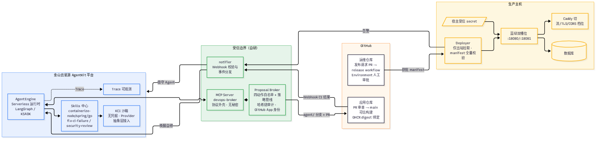
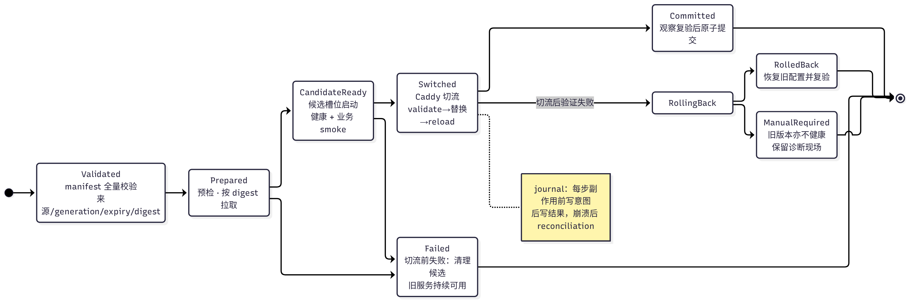
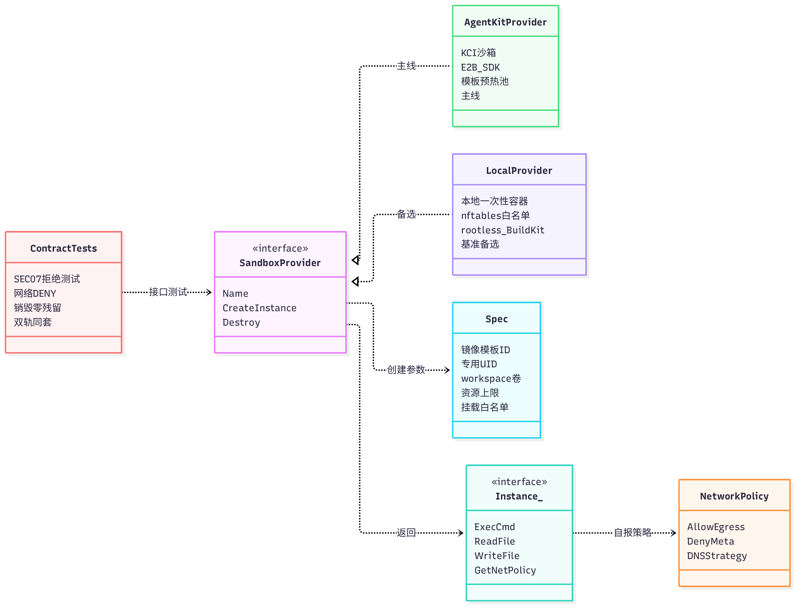

# 同舟 Shipmate

提报课题战队： 鬼点子不队

## 一、作品的详细说明（需包含技术实现方案，作品的功能）

### 1.1 作品是什么

同舟（Shipmate）把一个学生 Web 项目改造为可重复构建、可审批发布、可自动恢复、可持续运维的安全线上服务。AI Agent 托管在金山云星源 AgentKit 上承担全部工程劳动——容器化改造、构建验证、CI 报错自修、安全审查——但生产凭据、生产网络和发布决定权始终由受控边界与人工掌握。一句话：**AI 划桨，你掌舵。**

学生无需 Docker、SSH、Linux、GitHub 高级配置基础：服务器初始化由 bootstrap 脚本一条命令完成，GitHub 保护规则由 setup 脚本幂等配置，CI 报错由 Agent 消化重试，学生只在审批节点核对并批准。

### 1.2 总体架构

四层结构：

- **AgentKit 平台层（蓝）**：AgentEngine Serverless 运行时承载 Agent 主循环（LangGraph/KSADK）；Skills 中心承载 DevOps 流程知识（containerize-node/spring/go、fix-ci-failure、security-review-app）；KCI 沙箱提供无凭据隔离执行；Trace 提供调用链可观测。
- **受信边界（绿，自研）**：Proposal Broker 暴露且仅暴露四个白名单动作（repo.read / proposal.submit / ci.read / sandbox.build），经 MCP Server 以标准协议接入 Agent；持有唯一的 GitHub App 身份；每次调用过"认证→限流→Schema→动作策略→结果过滤→哈希链审计"管线。notifier 接收 GitHub Webhook，事件驱动唤醒 Agent 自修；Deployer 告警经 notifier 双出口（人类渠道 + 值守 Agent 诊断 PR）。
- **GitHub 层**：应用仓库（PR 审查 → main 可信构建 → GHCR 镜像 digest 绑定 source_sha）；运维仓库（发布请求 PR → production Environment 人工审批 → 获批 manifest）。**Agent 对运维仓库无任何通道。**
- **生产层（黄）**：Deployer 仅出站拉取，对 manifest 做全量核验（来源仓库/workflow/head_sha/run 结论/generation 单调/哈希锁定/有效期）；蓝绿双槽位（127.0.0.1:18080/18081）；Caddy 切流与 TLS（无域名时 `tls internal` 自签，CORS 档位在 Caddy 层注入，应用零改动）；生产凭据只存在于宿主受信目录。

**生产链路完全不经过 AgentKit**——平台不可用只影响沙箱任务排队，不影响部署、回滚与告警。

### 1.3 Agent-in-the-Loop 工作流

一次典型任务的全链路：维护者发起任务 → orchestrator 起一次性沙箱并从 Broker 领取绑定实例的短时 session_token → Agent 读代码判断技术栈（repo.read）→ 沙箱内写 Dockerfile 与健康端点 → 真实构建验证（sandbox.build）→ 提交 patch（proposal.submit，Broker 逐 hunk 校验路径/符号链接/控制文件后建 agent/ 分支开 PR）→ CI 失败经 Webhook 即刻唤醒 Agent → 读筛选日志（ci.read）→ 修复重提 → 全绿 → 沙箱销毁、token 作废 → 维护者审查合并 → 走发布协议（Agent 不再参与）。

Agent 的工具面即能力面：只有 shell（沙箱内）和 broker_call（四动作）。没有 push、任意 HTTP、SSH、merge、审批等任何工具。四层纵深限制：网络层（沙箱宇宙里没有 GitHub，DENY 云元数据/DNS 重绑定）、身份层（零凭据，物理上无物可泄）、Broker 策略层、GitHub 平台层（App 权限与分支保护兜底）。

### 1.4 发布状态机与自动回滚

Deployer 是一个显式状态机：Validated（manifest 全量校验）→ Prepared（预检/按 digest 拉取）→ CandidateReady（非活跃槽位启动候选，健康 + 业务 smoke）→ Switched（Caddy validate → 原子替换 → reload 切流）→ Committed（60–120s 观察窗口业务复验后原子提交）。切流前失败仅清理候选，旧服务持续可用；切流后失败自动回滚并复验；旧版本亦不健康进入 ManualRequired 保留现场。每步副作用前写意图后写结果（journal），崩溃后依据 journal 与真实代理状态 reconciliation。同一 manifest 重复执行返回 ALREADY_APPLIED，零新增副作用。

### 1.5 沙箱抽象层：平台主线 + 自建可切换

沙箱能力收敛为语言无关的抽象接口（Provider 生命周期 / Instance 命令执行与文件交换 / NetworkPolicy 出站白名单与元数据防护）。两个 plugin 后端：**agentkit**（KCI 沙箱，主线，模板预热加速）与 **local**（本地一次性容器 + nftables 白名单 + rootless BuildKit，零平台依赖的基准实现）。**契约测试套件与后端无关**：SEC07（宿主文件/元数据/Docker socket 访问拒绝）、网络 DENY、资源上限、销毁零残留等用例直接针对接口编写，双轨跑同一套——KCI 隔离粒度是否达标由实测裁决。切换后端 = 换一个环境变量，Broker、发布协议、Deployer 零改动。

### 1.6 功能清单

| 功能 | 说明 |
| --- | --- |
| 一键本地闭环 | make dev-up / smoke / dev-down，示例配置无秘密，干净机器可复现 |
| 语言无关应用改造 | HTTP 契约（livez/readyz/version、优雅退出、超时治理）+ Go/Node/Spring Boot 三份模板，Agent 探测技术栈自动选用 |
| CI 按信任等级拆分 | PR checks → main 可信构建 → 隔离镜像推送 → candidate 元数据（SBOM、digest、来源绑定） |
| 获批发布协议 | ops 发布请求 → Environment 人工审批 → 严格 Schema 的 manifest（generation 单调、短期有效、内容哈希锁定） |
| 蓝绿部署与自动回滚 | 双槽位、Caddy 原子切流、观察窗口、journal 崩溃恢复，应用回退 ≤120s |
| Agent 工程化 | AgentKit 运行时 + Skills + MCP 四动作 + Webhook 事件闭环，全程零 token 下发 |
| 安全验证体系 | 20+ 自动化用例：权限越界（SEC）、部署故障（DEP）、数据兼容（DATA）、灾难恢复（OPS），全部以 API/网络/文件实际结果为证据 |
| 部署档位 | tls_mode（http/internal/auto）、cors_mode（open/白名单）、access（ip_port/域名），只在宿主受信配置，Agent 改不了，升级是一行配置 |
| 数据安全 | expand-contract 迁移、迁移锁、每日备份 + 异地副本、空白实例恢复演练（RPO≤24h，RTO≤60min） |

### 1.7 技术实现要点

- **Proposal Broker / Deployer**：单二进制常驻服务/CLI + systemd timer，严格 JSON Schema（additionalProperties=false），路径规范化与内容允许列表，哈希链审计（hash = SHA256(prev‖canonical_json)）外发独立日志端。
- **Webhook 事件驱动**：notifier 做 GitHub 签名校验与会话关联过滤，调 AgentEngine 运行时 API 唤醒 Agent；Webhook 未扩大 Agent 任何权限（Agent 收到的都是它本可用 ci.read 拿到的信息）。
- **凭证分层**：AgentKit 平台凭证（IAM AK/SK、API-Key）只放控制台密文变量；GitHub App 私钥只在 Broker；生产 secret 只在宿主受信目录；session_token 短时绑定沙箱实例。任何凭证不进入 Agent 会话上下文。
- **部署排期**：23 天四线并行（应用改造 / CI+审批 / Deployer / 沙箱+Broker），D1–2 冻结 manifest Schema 与审计格式作为三线契约，D16–18 Agent 全链路接入，D19–20 全量攻击测试，D21 双彩排。

## 二、作品计划达到的技术创新性

1. **"工具面 = 能力面"的 Agent 权限模型**：Agent 的能力由工具清单结构性定义，而非提示词约束。四动作白名单 + 零凭据沙箱 + 四层纵深防御，使"Agent 泄露生产凭据"这一风险类别被物理消除——不是藏起秘密，而是秘密从未进入 Agent 的世界。区分"秘密内容不可见"与"生产能力不可用"：约束的是能力本身。
2. **MCP 给手、Skills 给脑的分层接入范式**：将云平台 Agent 能力（AgentKit）与自研安全边界（Broker）以标准协议组合——MCP 承载能力白名单，Skills 承载流程知识——Agent 获得完整 DevOps 劳动能力，而信任决策链零外包。为"企业 Agent 平台如何安全接入自有受控系统"提供了可复制的模式。
3. **后端无关的沙箱抽象层与契约测试裁决机制**：平台沙箱（KCI）与自建沙箱跑同一套隔离契约测试，用实测证据而非供应商声明裁决隔离粒度；切换后端零改造上层。这既是工程可移植性设计，也是对"云沙箱是否足够安全"这一行业问题的可验证回答。
4. **事件驱动的 Agent 自修闭环**：CI 失败 Webhook → 唤醒 Agent → 读筛选日志 → 修复重提 → CI 转绿，全程无人工干预且 Trace 可回放。把"学生看不懂 CI 报错"这一现实障碍转化为 Agent 的核心价值场景。
5. **结构性人工门禁的发布授权协议**：获批 manifest（digest 绑定 source_sha、generation 单调、内容哈希锁定、短期有效）+ 生产仅出站拉取 + 全字段核验。Agent 既造不出也伪造不了这张"通行证"——信任来自结构，不来自提示词。攻击测试（伪造 manifest、重放旧 generation、篡改已接受资产）100% 拒绝均有 API 级证据。
6. **完整状态机 + journal 的部署可靠性**：显式状态机、意图-结果持久化、崩溃 reconciliation、蓝绿双槽位幂等，把"compose up 幂等"升级为带业务验证、补偿路径和故障分类的发布工程。

## 三、作品的实用性说明

### 3.1 解决的真实痛点

- **对学生/课程项目**：项目"本地能跑、上线即崩"，且普遍缺少 SQL 注入、跨域、凭据管理等安全意识与部署运维能力。同舟把从学生项目到安全线上服务的全流程跑通并交付为可复用范式，学生的能力门槛从"会操作 Docker/SSH/Linux/GitHub 高级配置"降为"能看懂提示并做出批准决定"。
- **对引入 AI Agent 的团队**：直接给 Agent 仓库写权限和 .env 访问权是当前普遍做法，等于把生产凭据暴露在提示注入攻击面内。同舟的 Broker 模式是即插即用的替代：Agent 劳动能力完整保留，权限越界被结构性拦截。
- **对云平台生态**：验证了 AgentKit（沙箱/MCP/Skills/运行时）承载真实 DevOps 工作流的安全接法，产出 Skill 契约测试与平台故障分类，可直接复用于其他 AgentKit 企业接入场景。

### 3.2 使用方式与适用场景

- 输入任意语言的学生 Web 项目（Go/Node/Spring Boot 已有模板），维护者一句话发起任务，Agent 完成容器化、CI 接入、上线准备。
- 无域名/备案环境开箱即用：Caddy `tls internal` 自签 + CORS 档位临时放开（Caddy 层注入，应用零改动），域名就绪后一行配置升级到正式 HTTPS 与 origin 白名单。
- 单机 Linux 云主机即可运行全部生产侧组件；`local` 沙箱后端支持完全离线的私有化部署。

### 3.3 交付物

容器化应用与契约模板、CI/CD workflow 全套、Proposal Broker 与 MCP Server、双后端沙箱 Provider 与契约测试、Go Deployer、五枚 Skills、bootstrap/setup 一键初始化、20+ 安全与故障用例证据包、部署运维 runbook、临时态清单与升级指引。

### 3.4 验收口径（可量化）

正常发布成功率 ≥19/20；定义的故障演练全部恢复、应用回退 ≤120 秒；权限越界必测用例 100% 拒绝（API/网络/文件实际结果为证）；重复 manifest 执行零新增副作用；RPO≤24h、RTO≤60min（空白实例实测）；Agent 进程/上下文/日志/镜像层凭据扫描零命中；双沙箱后端契约测试全过；CI 注入失败 → Agent 自动修复转绿闭环可演示；模拟 AgentKit 不可用时生产链路不受影响。
