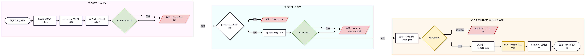

# 同舟 Shipmate

提报课题战队：鬼点子不队

> 方案状态：采用拓扑 B 的有界 MVP 设计；下述功能与指标为计划交付和验收目标，不代表已有实现或测试通过。详细技术约束见 [core.md](core.md)、[agent-runtime.md](agent-runtime.md) 和 [implementation.md](implementation.md)。

## 一、作品的详细说明

### 1.1 作品是什么

同舟（Shipmate）帮助学生团队把一个明确支持的 Web 项目接入可重复构建、可审批发布、可回滚的运维流程。AI Agent 托管在金山云星源 AgentKit 上，承担容器化改造、构建验证和限定范围的 CI 自修；人类保留代码审查、基础设施变更与发布决定权。**AI 划桨，你掌舵。**

安全目标是：**未经批准的 Agent 会话不能直接读取生产秘密、访问生产网络或授权发布。** Agent 生成的业务代码若获批上线，仍可能使用应用合法持有的数据库/API 权限，因此需要独立审查、最小权限与运行时控制；不宣称物理消除所有凭据泄露。

bootstrap/setup 脚本计划减少 Docker、Linux 和 GitHub 配置操作负担，但账号权限、审批判断、证书信任与异常处置仍由维护者负责，不把“自动化”解释为“无需任何工程判断”。

### 1.2 总体架构：拓扑 B

五个明确的执行与授权边界：

- **受信 Agent 运行时**：AgentEngine + KSADK/LangGraph 运行模型客户端、编排和固定工具适配器。模型/平台凭证只给需要它们的受信组件；模型上下文不含认证材料。禁止在这里执行模型生成或仓库提供的任意 shell/Python/Skill 脚本。
- **不可信执行区**：SandboxProvider 提供独立 workspace、shell 与文件操作；BuildExecutor 消费不可变快照，在另一临时环境进行真实构建。两者均不持有模型、平台、Broker、GitHub 或生产凭据，不接触生产网络和宿主 Docker socket。
- **提案边界（自研）**：受信适配器经服务身份与短期会话认证调用 MCP/Broker，仅开放 repo.read / proposal.submit / ci.read / sandbox.build。Broker 持有 app 仓库 GitHub App 身份，执行授权、限额、Schema、路径/最终树策略、结果过滤和审计。
- **GitHub 发布边界**：应用 PR 审查合并 → main 可信构建与隔离镜像推送 → digest 绑定 source_sha；独立 ops 仓库发布请求 → production Environment 人工审批 → 获批 manifest。Agent 无 ops 工具通道和身份。
- **生产边界**：Deployer 仅出站拉取，核验仓库/workflow/不可变提交/run_attempt/实际审批 job/请求内容/generation/有效期后按 digest 发布；固定蓝绿双槽位、Caddy 切流和本地 journal 恢复。生产业务、部署、迁移、备份凭据分开授予。

AgentKit 故障影响 Agent 任务、CI 自修与诊断；**独立生产部署、已接受事务的本地恢复与人类告警不依赖 AgentKit**。这不意味着新部署完全不依赖 GitHub 或镜像仓库。

### 1.3 Agent-in-the-Loop 工作流

维护者授权任务 → 受信调度器登记会话并创建独立沙箱 → 适配器调用 repo.read，代码写入 workspace → shell 在沙箱修改 Dockerfile 与健康端点 → 冻结/登记不可变快照 → sandbox.build 调独立 BuildExecutor 完成构建与 smoke → proposal.submit 校验精确 Git tree、文件模式与最终 diff，创建受管 PR → CI 失败经 notifier 验签、去重、持久队列和当前提交关联后唤醒同一会话 → 读筛选日志，在预算内修复并更新 PR → 撤销会话、回收构建和沙箱 → 人类审查合并与独立发布审批。

模型只有 shell（远程沙箱）和 broker_call（四动作）工具；实际能力由适配器、Broker、OS、挂载、网络及 GitHub 规则共同限制，不靠工具名称或提示词保证安全。Broker 会话材料留在受信适配器，沙箱不直连 Broker/模型/平台管理 API。服务端固定仓库、基线、PR、workspace/snapshot 和预算，不信任模型自报身份或实例 ID。

自修仅面向首版明确的测试/构建错误，设置轮数、时间、模型费用和构建次数上限。workflow 权限、审批和平台故障转人工待办；不能通过删除受保护测试或放开权限让 CI 假绿。

### 1.4 发布状态机与自动回滚

Validated（授权与内容绑定）→ Prepared（预检、按 digest 拉取）→ CandidateReady（候选启动、健康与业务 smoke）→ Switched（Caddy validate、替换、reload、真实入口验证）→ Committed（观察复验后提交）。

切流前失败清理候选；切流后失败按类别恢复旧代理目标并复验；旧版本也不健康进入 ManualRequired。首次部署无 previous，不能把失败记成回滚成功。每步副作用前写意图、后写结果，崩溃后结合 journal、代理运行态、容器身份及业务入口协调；重复当前成功 manifest 核对状态后返回 ALREADY_APPLIED，无新增部署副作用。

应用回滚不撤销数据库写入或外部副作用，也不提供单机故障下高可用。旧镜像和必要资源本地保留；回退目标≤120s 从检测失败计到旧业务恢复，另计检测延迟。

### 1.5 执行底座：沙箱与构建分离

SandboxProvider 管理生命周期、命令、文件和一致性快照；BuildExecutor 管理固定构建预设、资源预算、作业取消、结果与孤儿回收。优先验证 KCI 工具沙箱；KCI 独立构建实例若不满足构建权限/网络/清理条件，使用专用节点临时 VM，而不是放开宿主能力。

首版只交付一个通过门禁的组合，local 与第二后端完整交付后置。验证包括共享行为测试与后端专属证据；配置自报不等于策略生效，有限测试通过不证明容器与 VM 等强度或物理零残留。构建节点与生产主机分离；rootless 不自动提供完整隔离。

工具沙箱默认禁止外联，源码和输出由受信控制端交换。构建优先预置依赖离线执行；确需下载时采用独立受控下载阶段，覆盖 DNS、重定向、IPv6、元数据与内网限制，并隔离不可信与可信构建缓存。local 后端不等于整系统完全离线。

### 1.6 功能与首版范围

| 功能 | 首版计划 |
| --- | --- |
| 应用改造与本地闭环 | 一个明确支持的无本地持久状态 HTTP 应用；livez/readyz/version、优雅退出、超时、容器化与 smoke |
| Agent 工程化 | AgentEngine 拓扑 B、固定工具适配、MCP 四动作、一个容器化流程及一种 CI 错误自修 |
| 执行底座 | 一个通过隔离门禁的 SandboxProvider + 独立 BuildExecutor 组合 |
| CI 与发布授权 | PR 检查、main 构建、隔离推送、候选来源绑定、ops 审批和严格 manifest |
| 部署与恢复 | 双槽位、Caddy、观察窗口、journal、幂等与关键崩溃窗口恢复 |
| 初始化与告警 | bootstrap/setup 预检与幂等配置；独立人类通知，不等待 AgentKit |
| 安全验证 | 身份/路径/网络负例、发布篡改与重放、资源/回收、故障测试和证据包 |
| 数据 | 默认迁移 none；如含持久数据，增加 N/N−1 兼容、独立备份与空白实例恢复 |

第二后端、更多语言模板、五枚云端 Skills、值守 Agent、复杂迁移、多架构与完整离线部署后置。若比赛要求云端 Skills，首版只增加一个可证明实际调用的专用 Skill，不在持凭证运行时执行其不可信脚本。

### 1.7 技术实现要点

- **认证与凭证**：受信适配器采用 mTLS 服务身份 + 短期会话材料调用 Broker；材料不进入模型/沙箱。平台 MCP 网关若参与认证终止，先验证服务身份与会话隔离，不静默降级。密文变量不是进程内无明文的保证。
- **授权与幂等**：GitHub App 最小 Contents/PR 写、Actions 读；实际 main 更新约束由规则与 API 负例验证。manifest 首次接受前也做内容绑定，不能只锁首次下载哈希；rerun、workflow 切换和失败版本有明确序号规则。
- **审计**：严格 JSON 输入、重复键拒绝、规范化事件哈希链、持久 outbox 与外部锚定；用于发现篡改，不声称绝对不可篡改。
- **23 天预算**：四人分工，D1–3 平台薄链路/认证/真实构建隔离/审批 PoC，D4–7 单应用最小链路，D8–15 自修与恢复加固，D16–20 负例和证据，D21–23 彩排缓冲。门禁失败先缩非核心范围，不削弱安全边界。

## 二、作品计划达到的技术创新性

1. **提案与发布双边界**：让 Agent 真正修改代码、构建与修复 CI，但不拥有生产授权通道。区分会话隔离与获批代码风险，安全声明有明确适用范围。
2. **拓扑 B 的凭证与执行分离**：模型客户端/固定适配器位于受信运行时，任意代码进入独立沙箱；MCP 承载受限动作，Skills 承载流程，不以隐藏凭证替代权限限制。
3. **沙箱与构建的独立替换机制**：平台适合工具执行但不适合安全镜像构建时，可以独立替换 BuildExecutor；以实际工作负载和隔离证据决定选型。
4. **有界事件自修**：CI 事件经去重、提交关联和持久队列触发修复，设明确预算和人工回退，保留独立验收防止假绿。
5. **可验证发布与恢复**：精确来源/digest/审批绑定、重放防护、journal、实际代理状态和业务复验组合成可审计发布事务。

创新主要在安全边界、授权协议与证据驱动的工程集成，不宣称发明新的底层隔离算法。

## 三、作品的实用性说明

### 3.1 解决的痛点

学生项目常缺少容器化、CI 诊断、权限分层、发布审批和回滚经验。同舟将重复工程动作自动化，将高风险决定保留给维护者，并提供可复用模板、预检与 runbook。

对引入 AI Agent 的团队，提供一种不向不可信代码下发平台/GitHub/生产凭据的接入方式；对云平台生态，产出真实工作负载下的适配与隔离证据，而非仅演示“工具已配置”。

### 3.2 使用方式与限制

- 输入首版支持的 HTTP 应用，维护者授权任务，Agent 完成限定改造与构建，失败超出能力时生成待办。
- 单 Linux 主机承载生产组件，构建执行节点/环境独立。单机不等于高可用。
- 无域名演示可用 Caddy internal，但客户端必须信任内部 CA；http 只用于无敏感数据的受控演示，不关闭 TLS 校验来宣称 HTTPS 成功。
- CORS open 仅适合无跨域凭据场景，需处理 OPTIONS 与重复响应头；档位受宿主控制，但不保证任意应用零改动。
- 正式域名、TLS、访问控制和数据策略升级需验证业务兼容；local 沙箱不替代 GitHub/GHCR/模型/包源等在线依赖。

### 3.3 交付物

一个应用与契约模板、CI/审批 workflow、Go Broker/MCP、固定工具适配器、一个沙箱/构建组合、Go Deployer、bootstrap/setup、独立告警、验收证据包及 runbook。适用时增加持久数据恢复证据；其余能力按后置清单交付，不将设计文档当作已有代码。

### 3.4 验收口径（待实测目标）

- 固定 20 次正常发布至少 19 次成功；定义故障演练有正确结果；检测失败到旧业务恢复≤120s。
- 必测权限越界、发布伪造/重放全部拒绝；重复当前成功 manifest 无新增部署副作用；关键崩溃窗口可恢复。
- 模型上下文、沙箱/构建区、工具结果、Trace/日志和镜像层规定凭据样本扫描零命中；不声称合法持凭证进程内存无秘密。
- 一个后端组合通过契约门禁；CI 固定错误在预算内自修，重复/过期事件不产生重复写。
- AgentKit 中断时独立发布、本地恢复与人类告警继续工作。
- 含持久数据时空白实例实测 RPO≤24h/RTO≤60min；不含则明确不适用。

以上样本结果不等于长期 SLA、绝对安全或全部故障可恢复。每项须附版本、环境、原始结果、失败/重试与适用范围。
